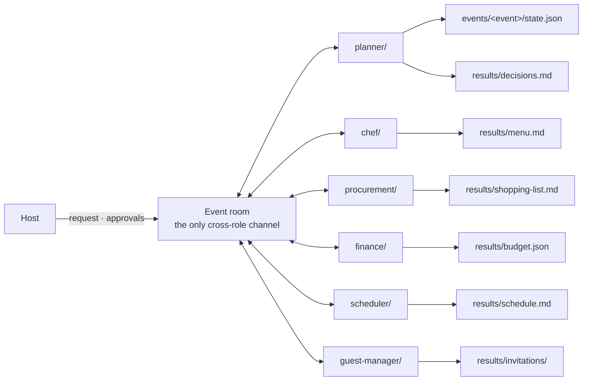
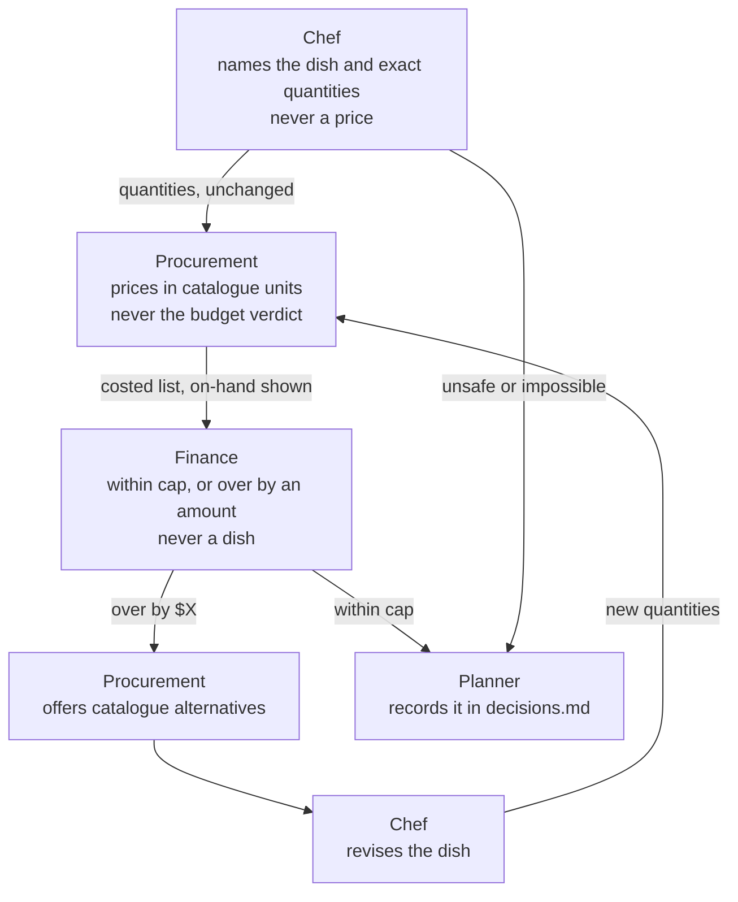
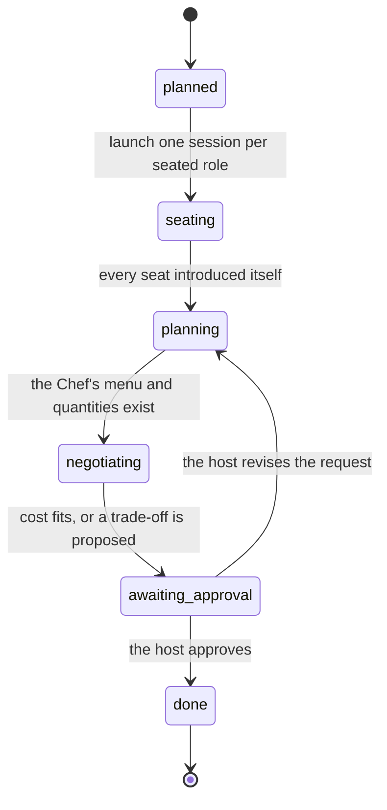

# Dinner Party — composable multi-agent event team

A **fictional, local-only** fixture for an agent factory. Six positional roles plan an event — each
running as its own session, in its own directory, talking only through the event room.

The role directories are the product; they never change between occasions. Composing Thanksgiving, a
birthday or a New Year's dinner means a new folder under `events/` and a new room.

## What is unusual here

- **Roles are positional.** There is a Chef, not a person named Remy. A per-event `display_names`
  entry can label a role in one room and changes nothing about its authority.
- **Each role is a session with a closed file list.** It writes only the files its `AGENTS.md`
  names. No note files, no second menu, no copies of someone else's data.
- **One writer per deliverable.** `results/menu.md` is the Chef's, `budget.json` is Finance's, and
  so on. Corrections arrive as messages, and the owner republishes.
- **Nothing is seeded.** Every role starts with capability knowledge only — a recipe catalogue, a
  price catalogue, a budget method, a scheduling method, a dietary-handling method, the Planner's
  roster. There is no guest list, no calendar, no pantry and no cap beyond the brief.
- **No invented facts.** A value that was not given to the role is recorded `unknown` and asked for.
  A plausible guess is a failure, not progress.
- **A missing fact becomes a blocker, not a paragraph.** Open approvals and blockers collect in the
  Planner's `state.json`, each with an owner.
- **Every role has a falsifiable Definition of done**, in its `ROLE.md`.

## An event is a folder plus a room

| File | Writer | Holds |
| --- | --- | --- |
| `events/<event>/brief.md` | setup input, read-only to agents | the host's request: occasion, date, headcount, budget, constraints |
| `events/<event>/manifest.json` | setup input, read-only to agents | the room and the `seated` list, optional `display_names` |
| `events/<event>/state.json` | the Planner only | `phase`, `seats`, `open_approvals`, `blockers` |

An event is complete only when all three exist. Two live here:

- **`events/dinner-2026-11-28/`** — the fixture. Brief, manifest and state are all present and the
  state is at `phase: planned` with every seat unseated. Start here.
- **`events/thanksgiving-2026-11-26/`** — a host-defined run. It has `state.json` only: the host gave
  the brief in the room and the Planner correctly declined to author `brief.md` or `manifest.json`.
  Read it as an example of blockers being recorded, not as a launchable event until the host writes
  those two files.

## Three ways to use it

| Mode | What you get | How |
| --- | --- | --- |
| **Full team** | The real test: delegation, handoffs, lane discipline, replanning | Launch one session per seated role per `LAUNCH.md`, all in one event room |
| **Single role** | Exercise one contract with you as the host and counterparty | Start a session in that role's folder and talk to it — see **Solo** below |
| **File fallback** | A dry run with no room | Drop a fixture in `messages/inbox/` and relay outputs by hand; collaboration counts as untested |

## Quick start

1. Read [`LAUNCH.md`](LAUNCH.md), then [`DEMO_SCRIPT.md`](DEMO_SCRIPT.md) and
   [`organization.md`](organization.md).
2. Pick an event folder, e.g. `events/dinner-2026-11-28/`. Confirm `brief.md`, `manifest.json` and
   `state.json` all exist.
3. Launch **one session per seated role**, rooted in that role's directory. Give each only its own
   folder, the root documents, the event `brief.md`, and read-only `results/`.
4. Submit the host request from `brief.md` to the Planner. Roles introduce themselves, the Planner
   seats them, and work flows along the handoff chain.
5. To disrupt the plan, deliver a file from `fixtures/` to the role that owns it, as a message.
6. Inspect `results/`. Each file has one owner; schemas are in [`results/README.md`](results/README.md).
7. Replay: restore the tree and relaunch fresh sessions (see `LAUNCH.md` → Replay).

Set the simulation clock to **2026-11-23** and verify no network access.

## Solo: trying one role on its own

Every contract has a **Solo mode** clause. Start a session in a role's folder, tell it you are the
host, and it answers directly — no room, no introduction — while keeping the file rules and the
no-invention rule.

```bash
cd chef          # or procurement, finance, scheduler, guest-manager, planner
# then: "Read AGENTS.md, ROLE.md, README.md, ../AGENTS.md, ../organization.md and
#        ../events/dinner-2026-11-28/brief.md. You are the Chef. I'm the host."
```

Good things to try:

- Ask the Chef for a menu. It should ask you for headcount, dietary constraints and timing rather
  than assuming them.
- Ask the Chef to price the ingredients. It should refuse and tell you Procurement owns that.
- Ask Finance to check a $380 list. It should ask for the costed lines rather than inventing prices.
- Ask the Guest Manager to add a guest. It should say the host has not approved it.

## The specialists

Six roles. Each is a separate session rooted in its own directory, and each can be omitted from an
event by trimming `seated` in the manifest. The full contract, including the Definition of done,
lives in each role's `ROLE.md`.

**Planner** — `planner/`
- Composes the team for one event, seats it, routes work, reconciles findings, owns the decision
  record and the event state.
- Publishes `results/decisions.md`; maintains `events/<event>/state.json`.
- Alone may say "the host approved". Never prices, plans a menu, confirms a guest or sets a
  timetable.

**Chef** — `chef/`
- Owns the recipe catalogue, the menu, exact ingredient quantities, dietary safety and preparation
  order.
- Publishes `results/menu.md`.
- Never prices, budgets, confirms a guest or decides service time.

**Shopper (Procurement)** — `procurement/`
- Owns the price catalogue, supplier facts and stock status; turns the Chef's quantities into a
  costed list.
- Publishes `results/shopping-list.md`.
- Never changes the menu or quantities, declares whether the budget fits, or purchases.

**Finance** — `finance/`
- Owns the budget method and reserve policy, and is the only role that may rule a list within or
  over the cap.
- Publishes `results/budget.json`.
- Never chooses a dish or a substitute, raises the cap, or approves spending.

**Scheduler** — `scheduler/`
- Owns the calendar and the event timetable: arrivals, kitchen access, prep and service timing.
- Publishes `results/schedule.md`.
- Never confirms attendance, accepts an RSVP, or moves a time without the host.

**Guest Manager** — `guest-manager/`
- Owns the guest roster, RSVP state, dietary constraints and invitation drafts.
- Publishes `results/invitations/`.
- Never invites or accepts without host approval, sends anything, or prescribes a dish.

## How the roles fit together

Each role is its own session, rooted in its own folder. The room is the only way they talk. The
`results/` files are the only way they hand over an artifact, and each has exactly one writer.



The handoff chain is the part that proves lanes do not cross. Each arrow is a message, and each box
may speak only for its own domain:



The Planner tracks the event through a fixed set of phases, and `state.json` is the only place that
phase lives:



## Data isolation

| Tier | Path | Read | Write |
| --- | --- | --- | --- |
| Capability knowledge | `<role>/data/` | owning session | owning session |
| Working state and tasks | `<role>/workspace/` | owning session | owning session |
| Event record | `events/<event>/` | seated sessions | Planner owns `state.json`; `brief.md` and `manifest.json` are setup input |
| Published deliverables | `results/` | everyone | exactly one owner per file |

## Structure

- `AGENTS.md` — organization-wide rules
- `organization.md` — roles, team protocol, data ownership, handoff chain
- `LAUNCH.md` — launching one session per role; replay
- `events/` — one folder per event: `brief.md`, `manifest.json`, `state.json`
- `chef/`, `guest-manager/`, `scheduler/`, `procurement/`, `finance/`, `planner/` — one role each:
  `AGENTS.md` (entry), `ROLE.md` (contract and Definition of done), `README.md` (files and schemas),
  capability `data/`, private `workspace/`
- `messages/` — local fallback inbox
- `results/` — published deliverables, one owner per file
- `fixtures/` — presenter-only scenario events
- `DEMO_SCRIPT.md` — talk track

Python is not required. **This repository is a fixture, not an agent runtime** — your agent factory
supplies sessions, routing and messaging.

## Network and the room

The no-network rule is org-wide (`AGENTS.md` rule 12) and repeated in each role's `## Never`. It
applies to the presenter too: an agent that refuses to fetch a URL is behaving correctly, not
broken.

- **Why:** the fixture only works if every identity, price and record is fictional. A live fetch can
  smuggle real data in and quietly make a "fictional" plan non-fictional.
- **The room is not an exception the agent has to reason about.** The harness carries the messages;
  the agent never makes its own web calls. That is why the contracts say "the room and message
  channel your harness provides" and never name Parle.
- **No URLs exist in this repo**, agent-facing or otherwise, by design. If an agent was handed a URL,
  it came from the conversation.
- **If a role needs outside material,** paste the relevant text into the conversation rather than
  asking it to look something up.

## Intended outcome

A feasible menu covering every dietary constraint the host states, a service time that works for the
latest arrival, a costed list respecting the event's cap and reserve, drafts rather than sent
messages, and a decision record that never claims an approval the host did not give. When a fact is
missing, the plan says so and names who owes it.

## Approval boundaries

- The host approves attendance additions, time changes, and extra spending.
- The Planner reconciles specialist findings and publishes the decision record.
- Finance cannot increase the budget or permit purchases beyond the cap.
- Procurement cannot purchase or independently change allergy-relevant ingredients.
- Guest Manager cannot send invitations or accept new guests without approval.
- Specialists may message each other directly, but material findings and blockers go to the Planner.
