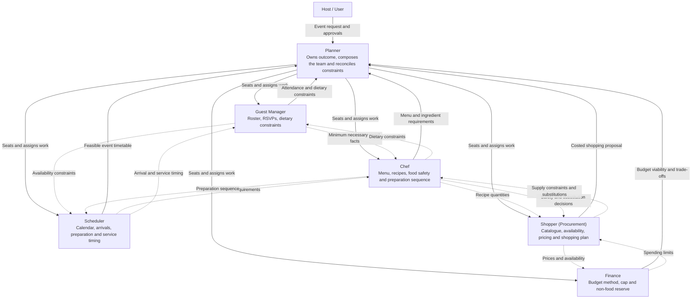

# Dinner Party — composable multi-agent event team

A **fictional, local-only** fixture for an agent factory. Six positional roles plan an event — a
three-course dinner for eight on **Saturday, November 28, 2026**, with a **$300 total cap** — each
running as its own session in its own directory, talking only through the event room.

The same role directories run any occasion. Composing Thanksgiving, a birthday or New Year's means
a new folder under `events/` and a new room — never an edit to a role.

## What is unusual here

- **Roles are positional.** There is a Chef, not a person named Remy. A per-event `display_names`
  entry can label a role in one room and changes nothing about its authority.
- **Each role is a session with a closed file list.** It writes only the files its `AGENTS.md`
  names. No note files, no second menu, no copies of someone else's data.
- **One writer per deliverable.** `results/menu.md` is the Chef's, `budget.json` is Finance's, and
  so on. Corrections arrive as messages, and the owner republishes.
- **Nothing is seeded.** Every role starts with capability knowledge only — a recipe catalogue, a
  price catalogue, a budget method, a scheduling method, a dietary-handling method, the Planner's
  roster. There is no guest list, no calendar, no pantry and no cap beyond the brief.
- **No invented facts.** A value that was not given to the role is recorded `unknown` and asked for.
  A plausible guess is a failure, not progress.
- **Every role has a falsifiable Definition of done**, in its `ROLE.md`.

## Network and the room

The no-network rule is org-wide (`AGENTS.md` rule 12) and repeated in each role's `## Never`. It
applies to the presenter too: an agent that refuses to fetch a URL is behaving correctly, not
broken.

- **Why:** the fixture only works if every identity, price and record is fictional. A live fetch can
  smuggle real data in and quietly make a "fictional" plan non-fictional.
- **The room is not an exception the agent has to reason about.** The harness carries the messages;
  the agent never makes its own web calls. That is why the contracts say "the room and message
  channel your harness provides" and never name Parle.
- **No URLs exist in this repo**, agent-facing or otherwise, by design. If an agent was handed a URL,
  it came from the conversation.
- **If a role needs outside material,** paste the relevant text into the conversation rather than
  asking it to look something up.

## Three ways to use it

| Mode | What you get | How |
| --- | --- | --- |
| **Full team** | The real test: delegation, handoffs, lane discipline, replanning | Launch one session per seated role per `LAUNCH.md`, all in one event room |
| **Single role** | Exercise one contract with you as the host and counterparty | Start a session in that role's folder and talk to it — see **Solo** below |
| **File fallback** | A dry run with no room | Drop a fixture in `messages/inbox/` and relay outputs by hand; collaboration counts as untested |

## Quick start

1. Read [`LAUNCH.md`](LAUNCH.md), then [`DEMO_SCRIPT.md`](DEMO_SCRIPT.md) and
   [`organization.md`](organization.md).
2. Pick an event folder, e.g. `events/dinner-2026-11-28/`. `brief.md` holds the host request,
   `manifest.json` the room and the `seated` list, `state.json` the Planner's progress record.
3. Launch **one session per seated role**, rooted in that role's directory. Give each only its own
   folder, the root documents, the event `brief.md`, and read-only `results/`.
4. Submit the host request from `brief.md` to the Planner. Roles introduce themselves, the Planner
   seats them, and work flows along the handoff chain.
5. To disrupt the plan, deliver a file from `fixtures/` to the role that owns it, as a message.
6. Inspect `results/`. Each file has one owner; schemas are in [`results/README.md`](results/README.md).
7. Replay: restore the tree and relaunch fresh sessions (see `LAUNCH.md` → Replay).

Set the simulation clock to **2026-11-23** and verify no network access.

## Solo: trying one role on its own

Every contract has a **Solo mode** clause. Start a session in a role's folder, tell it you are the
host, and it answers directly — no room, no introduction — while keeping the file rules and the
no-invention rule.

```bash
cd chef          # or procurement, finance, scheduler, guest-manager, planner
# then: "Read AGENTS.md, ROLE.md, README.md, ../AGENTS.md, ../organization.md and
#        ../events/dinner-2026-11-28/brief.md. You are the Chef. I'm the host."
```

Good things to try:

- Ask the Chef for a menu. It should ask you for headcount, dietary constraints and timing rather
  than assuming them.
- Ask the Chef to price the ingredients. It should refuse and tell you Procurement owns that.
- Ask Finance to check a $380 list. It should ask for the costed lines rather than inventing prices.
- Ask the Guest Manager to add a guest. It should say the host has not approved it.

## Structure

- `AGENTS.md` — organization-wide rules
- `organization.md` — roles, team protocol, data ownership, handoff chain
- `LAUNCH.md` — launching one session per role; replay
- `events/` — one folder per event: `brief.md`, `manifest.json`, `state.json`
- `chef/`, `guest-manager/`, `scheduler/`, `procurement/`, `finance/`, `planner/` — one role each:
  `AGENTS.md` (entry), `ROLE.md` (contract and Definition of done), `README.md` (files and schemas),
  capability `data/`, private `workspace/`
- `messages/` — local fallback inbox
- `results/` — published deliverables, one owner per file
- `fixtures/` — presenter-only scenario events
- `DEMO_SCRIPT.md` — talk track

Python is not required. **This repository is a fixture, not an agent runtime** — your agent factory
supplies sessions, routing and messaging.

## Data isolation

| Tier | Path | Read | Write |
| --- | --- | --- | --- |
| Capability knowledge | `<role>/data/` | owning session | owning session |
| Working state and tasks | `<role>/workspace/` | owning session | owning session |
| Event record | `events/<event>/` | seated sessions | Planner owns `state.json`; `brief.md` and `manifest.json` are setup input |
| Published deliverables | `results/` | everyone | exactly one owner per file |

## Intended outcome

A feasible menu covering vegan and shellfish-allergy requirements, a service time that works for
the latest arrival, a costed list respecting the total cap and non-food reserve, drafts rather than
sent messages, and a decision record that never claims an approval the host did not give.

## Agent organization



## Approval boundaries

- The host approves attendance additions, time changes, and extra spending.
- The Planner reconciles specialist findings and publishes the decision record.
- Finance cannot increase the budget or permit purchases beyond the cap.
- Procurement cannot purchase or independently change allergy-relevant ingredients.
- Guest Manager cannot send invitations or accept new guests without approval.
- Specialists may message each other directly, but material findings and blockers go to the Planner.
